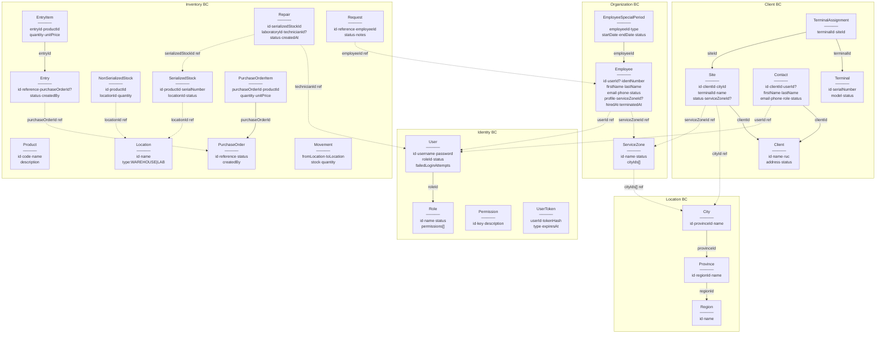

# Orbis — Architecture Reference

> Referencia rápida para contexto de IA. Evita leer múltiples documentos.

## Stack

| Componente | Tecnología |
|---|---|
| Backend | Symfony 8.0 / PHP 8.4 |
| Frontend | TailwindCSS + Turbo + Stimulus |
| DB | MySQL 8 (`cmscomec_orbis`) |
| IDs | ULID (26 chars, VARCHAR(26)) |
| Auth | Symfony Security + JWT (API) |
| ORM | Doctrine XML mappings only |
| Tests | PHPUnit 11 (140 unit tests) |

## Convenciones clave

- **Namespaces**: `App\{BC}\{Layer}\...` donde BC = `Identity`, `Organization`, `Client`, `Inventory`, `Location`, `Support`, `Shared`
- **Capas**: `Domain` → `Application` → `Infrastructure` | `Presentation`
- **Commands**: readonly DTOs. Handlers: `__invoke(Command): void|string`
- **Queries**: `__invoke(Query): Response|Response[]`
- **Rutas**: `#[Route(...)]` en controller. Permisos: `#[IsGranted('resource.action')]`
- **Repositorios**: Interface en Domain, implementación Doctrine en Infrastructure, binding en `config/services.yaml`
- **Soft deletes**: campo `deletedAt: ?DateTimeImmutable` en entidad + filtro en queries
- **Timestamps**: `TimestampableInterface` (marker) + `TimestampsSubscriber` vía Doctrine lifecycle
- **Brand colors**: sidebar `#1e3585`, accent `#00a86b`
- **Templates**: `templates/{recurso}/list|show|form.html.twig`

---

## Diagrama de Bounded Contexts y Entidades



---

## Rutas HTTP actuales

| Ruta (name) | Método | URL | Permiso |
|---|---|---|---|
| `app_home` | GET | `/` | ROLE_USER |
| `app_login` | GET/POST | `/login` | PUBLIC |
| `client_list` | GET | `/clients` | client.view_all |
| `client_new` | GET | `/clients/new` | client.create |
| `client_create` | POST | `/clients` | client.create |
| `client_show` | GET | `/clients/{id}` | client.view |
| `client_edit` | POST | `/clients/{id}/edit` | — |
| `client_activate` | POST | `/clients/{id}/activate` | client.activate |
| `client_deactivate` | POST | `/clients/{id}/deactivate` | client.deactivate |
| `client_delete` | POST | `/clients/{id}/delete` | client.delete |
| `contact_create` | POST | `/clients/{clientId}/contacts` | contact.create |
| `contact_deactivate` | POST | `/clients/{cId}/contacts/{id}/deactivate` | contact.update |
| `contact_reactivate` | POST | `/clients/{cId}/contacts/{id}/reactivate` | contact.update |
| `contact_delete` | POST | `/clients/{cId}/contacts/{id}/delete` | contact.delete |
| `site_add` | POST | `/clients/{clientId}/sites` | site.create |
| `site_show` | GET | `/clients/{clientId}/sites/{siteId}` | site.view |
| `site_edit` | POST | `/clients/{clientId}/sites/{siteId}/edit` | site.update |
| `site_deactivate` | POST | `/clients/{clientId}/sites/{siteId}/deactivate` | site.update |
| `site_reactivate` | POST | `/clients/{clientId}/sites/{siteId}/reactivate` | site.update |
| `employee_list` | GET | `/employees` | employee.view_all |
| `employee_new` | GET | `/employees/new` | employee.create |
| `employee_create` | POST | `/employees` | employee.create |
| `employee_show` | GET | `/employees/{id}` | employee.view |
| `employee_edit` | POST | `/employees/{id}/edit` | employee.update |
| `service_zone_list` | GET | `/service-zones` | service_zone.view_all |
| `service_zone_new` | GET | `/service-zones/new` | service_zone.create |
| `service_zone_create` | POST | `/service-zones` | service_zone.create |
| `service_zone_show` | GET | `/service-zones/{id}` | service_zone.view_all |
| `service_zone_edit` | POST | `/service-zones/{id}/edit` | service_zone.update |
| `service_zone_deactivate` | POST | `/service-zones/{id}/deactivate` | service_zone.update |
| `service_zone_reactivate` | POST | `/service-zones/{id}/reactivate` | service_zone.update |
| `service_zone_assign_technician` | POST | `/service-zones/{id}/assign-technician` | service_zone.assign_technician |
| `service_zone_remove_technician` | POST | `/service-zones/{id}/remove-technician/{techId}` | service_zone.assign_technician |
| `user_list` | GET | `/users` | user.view_all |
| `user_show` | GET | `/users/{id}` | user.view |
| `role_list` | GET | `/roles` | role.view_all |
| `role_show` | GET | `/roles/{id}` | role.view |

---

## Catálogo de permisos

```
user.*        view view_all create update delete verify activate deactivate reset_password
role.*        view view_all create update delete activate deactivate assign_permission
permission.*  view_all
employee.*    view view_all create update delete
client.*      view view_all create update delete activate deactivate
contact.*     view view_all create update delete
site.*        view create update
service_zone.* view_all create update assign_technician
ticket.*      view view_all create update delete assign reassign reschedule close reopen add_comment
expense.*     view view_all create update delete approve reject
inventory.*   view create update delete move_stock
purchase_order.* view view_all create update delete approve reject receive
repair.*      view view_all create update delete complete scrap
spare_part.*  view view_all create update delete transfer
warehouse.*   view view_all create update delete
```

---

## Patrones de código — Referencias rápidas

### Nuevo Command + Handler
```
src/app/{BC}/Application/Command/{Action}{Resource}/
  {Action}{Resource}Command.php  ← readonly DTO, public props
  {Action}{Resource}Handler.php  ← __invoke(Command): void
```

### Nueva Query + Handler + Response
```
src/app/{BC}/Application/Query/{Find|List}{Resource}/
  {Find|List}{Resource}Query.php
  {Find|List}{Resource}Handler.php  ← __invoke(Query): Response|Response[]
src/app/{BC}/Application/Query/Response/{Resource}Response.php
  ← readonly DTO + static fromEntity(Entity): self
```

### Nuevo Repository
```
src/app/{BC}/Domain/Repositories/{Resource}RepositoryInterface.php
src/app/{BC}/Infrastructure/Persistence/Doctrine/Doctrine{Resource}Repository.php
config/services.yaml  ← binding Interface: class: Implementation
```

### ORM Mapping (XML)
```
src/app/{BC}/Infrastructure/Persistence/Doctrine/Mapping/{Resource}.orm.xml
```

### Controller
```php
#[Route('/ruta')]
final class {Resource}Controller extends AbstractController
{
    #[IsGranted('resource.action')]
    #[Route('', name: 'resource_action', methods: ['GET'])]
    public function action(Handler $h): Response { ... }
}
```

---

## Estado de implementación

| BC | Domain | Infra | Application | Presentation | Tests |
|---|---|---|---|---|---|
| Identity | ✅ | ✅ | ✅ | ✅ | ✅ |
| Organization | ✅ | ✅ | ✅ | ✅ | ✅ |
| Client | ✅ | ✅ | ✅ | ✅ | ✅ |
| Location | ✅ | ✅ | ✅ | ⚠️ sin UI | ✅ |
| Inventory | ✅ | ✅ | ✅ | ⚠️ parcial | ✅ |
| Support | ⚠️ vacío | ❌ | ❌ | ❌ | ❌ |
| Shared | ✅ | ✅ | — | — | ✅ |

_Actualizado: 2026-05-11 · Tests: 140/140_
